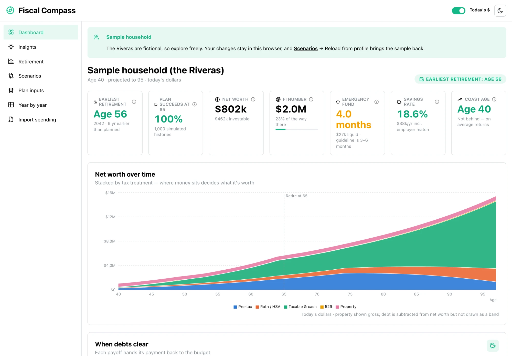
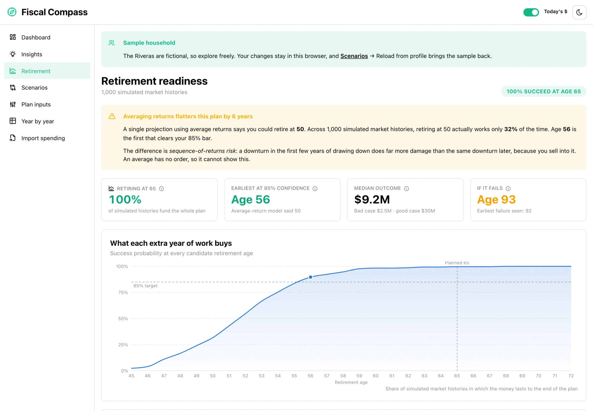
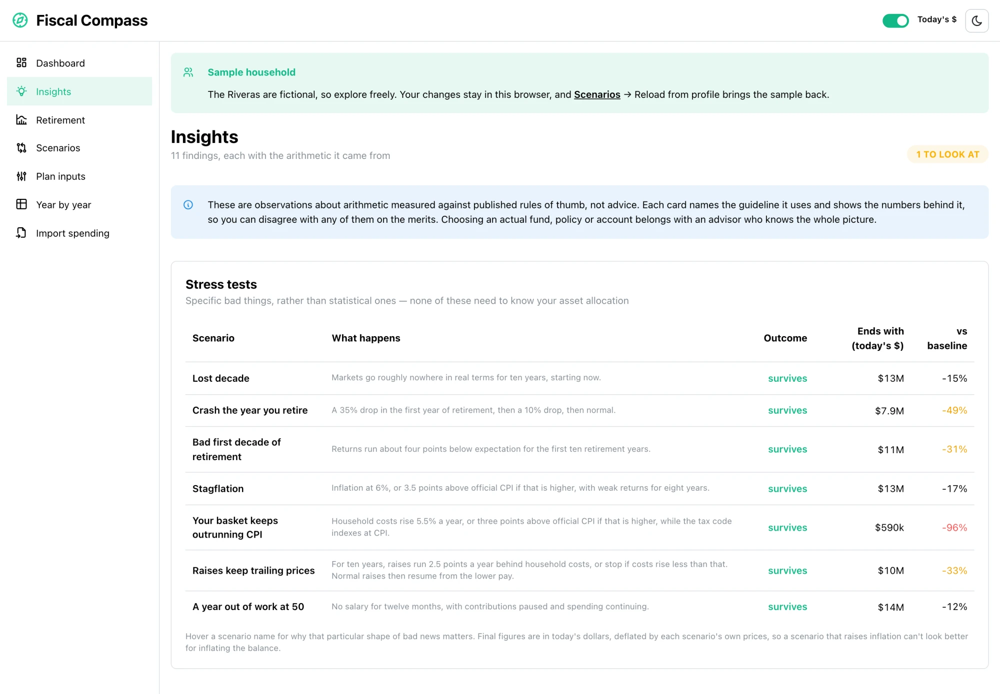
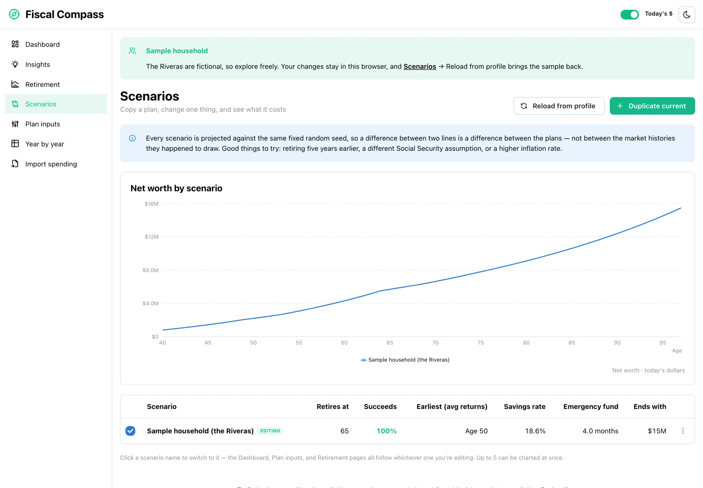

# Fiscal Compass

A local-first retirement and financial-stability planner. It projects a household
year by year to the end of the plan, **solves for the earliest age you could stop
working** and still fund every year, and shows where the money would be doing more
good somewhere else.

Built because the usual retirement calculator asks for four numbers and returns one,
and the interesting part — taxes, debt payoffs falling off, college years, the
pre-Medicare healthcare gap, RMDs forcing money out at 75 — is exactly the part it
throws away.

**Live demo:** [fiscal-compass.nineafterten.com](https://fiscal-compass.nineafterten.com),
running the fictional sample household.

<picture>
  <source media="(prefers-color-scheme: dark)" srcset="docs/screenshots/dashboard-dark.webp">
  
</picture>

> **Not financial advice.** Everything here is arithmetic applied to assumptions you
> control. The rules of thumb are shown with their math so you can disagree with
> them. Decisions about actual products belong with a licensed advisor.

## Screens

**Retirement readiness.** 1,000 simulated market histories, the earliest age that
clears an 85% bar, and what each extra year of work buys.

<picture>
  <source media="(prefers-color-scheme: dark)" srcset="docs/screenshots/retirement-dark.webp">
  
</picture>

**Insights.** Each finding shows the arithmetic it came from, starting with stress
tests for specific bad decades.

<picture>
  <source media="(prefers-color-scheme: dark)" srcset="docs/screenshots/insights-dark.webp">
  
</picture>

**Scenarios.** Copy a plan, change one thing, and compare them against the same fixed
random seed.

<picture>
  <source media="(prefers-color-scheme: dark)" srcset="docs/screenshots/scenarios-dark.webp">
  
</picture>

## Privacy

**Your data never leaves your browser.** No account, no server, no network calls of
any kind from the app. Balances live in IndexedDB on the device you typed them into.
The hosted demo sits behind Cloudflare, whose Web Analytics beacon counts page views
and load times for the whole domain, with no cookies and nothing you type.

The repo ships with a fictional sample household (`src/data/profiles/sample.ts`) so
it works the moment you clone it. Your real numbers go in
`src/data/profiles/local.ts`, which is **gitignored** and loaded automatically when
present. If you fork or publish this repo, confirm that entry is still in
`.gitignore` before you push.

Because the loader bundles `local.ts` whenever it exists, `npm run build` refuses
to run while the file is present (`scripts/guard-local-profile.mjs`). Deploy by
pushing to GitHub and letting Cloudflare build, where the file never exists.
`wrangler.jsonc` serves `dist/` as static assets with a single-page-app fallback, so
Cloudflare's build settings need only `npm run build` and `npx wrangler deploy`. A
build without `local.ts` shows a "Sample household" banner on every page.

## Run

```bash
npm install
npm run dev
```

| Command | Does |
|---|---|
| `npm run dev` | Vite dev server |
| `npm run build` | `tsc -b` + production build — must be clean. Refuses to run while `local.ts` exists |
| `npm run build:local` | The same build with your real profile, written to `dist-local/` (gitignored, never deployed) |
| `npm run test` | Vitest (watch); `test:run` and `coverage` also available |
| `npm run typecheck` | Types only |

## What it models

**Income** — salaries with real growth, self-employment, pensions, and Social
Security with a claim-age adjustment (−30% at 62, +24% at 70) and a *haircut* slider
for how much of the scheduled benefit you actually expect to arrive.

**Taxes** — graduated federal brackets, the standard deduction, FICA with the Social
Security wage base applied per person and the additional Medicare surtax applied
per return, up-to-85% taxation of Social Security via provisional
income, long-term capital gains stacked on top of ordinary income, Section 125
pre-tax payroll deductions, and a pluggable per-state adapter. Not modeled: itemized
deductions, AMT, NIIT, IRMAA. It's a planning approximation, not a tax return.

**Debts** — amortized monthly and exactly, then bucketed by year, so payoff dates
stay precise. When a loan clears, its payment leaves the budget and the freed cash
flows into the surplus cascade. This is often the biggest near-term swing in a plan.

**Spending** — phased by calendar year, by age, or by retirement status. That last
one is what makes the pre-Medicare healthcare bridge appear and resize on its own as
you move the retirement slider, which is usually what decides whether retiring early
is affordable at all.

**Withdrawals** — a configurable order across taxable, pre-tax and Roth, grossed up
for the tax the withdrawal itself creates (a short fixed-point iteration, since
withdrawing more pushes you into higher brackets). RMDs are forced out of pre-tax
accounts from age 75 whether the cash is wanted or not; the excess is swept into
taxable.

**Surplus** — leftover cash refills the emergency fund to its target first, then
invests. That cascade is the app's opinion about allocation, and it's visible and
adjustable rather than hidden.

## The headline numbers

- **Earliest retirement age** — the first age whose *success probability* clears your
  threshold across simulated market histories. Shown in preference to the
  average-return answer, which is reliably the more flattering of the two. The gap
  can be several years, because an average return ignores the bad sequences that
  sink an early retirement.
- **Coast age** — the age you could stop contributing entirely and still land on
  schedule. If it's already behind you, more saving buys margin rather than
  necessity. This is the honest test of whether you're overdoing it.
- **FI number**, **savings rate**, **emergency fund in months**, **withdrawal rate**.

## Simulation

Retirement calculators that report a single number are answering the wrong question.
A projection at average returns describes a market that has never existed — what
matters is **sequence-of-returns risk**: a downturn in the first years of drawing
down does far more damage than the same downturn later, because you sell into it.
Averaging has no order and cannot show this.

So every plan is also run against a thousand simulated histories. One standard-normal
market shock per year is applied across accounts as `expectedReturn + volatility × z`,
which makes risky assets perfectly correlated — that understates diversification, and
is the conservative direction to be wrong in. Real markets have fatter tails than a
normal distribution, so the bad case here is optimistic rather than a floor.

The random seed is **fixed**. Two consequences, both deliberate: the same plan always
gives the same answer, so a probability doesn't jitter while you drag a slider; and
every scenario is scored against identical market conditions, so a difference between
two scenarios is a difference between the plans rather than between their luck.

Simulation runs in a Web Worker — roughly 1.5s of arithmetic, fine in the background
and unacceptable on the main thread. It's debounced, and previous results stay on
screen (dimmed) while the next computes, because a chart that blanks on every
keystroke is worse than one that's briefly out of date.

## Scenarios

Duplicate a plan, change one thing, compare. Each scenario carries its own planned
retirement age and success probability, and up to five can be charted at once — past
that, colors would have to repeat and two different plans would look alike.

Windfalls (inheritances, vesting, a property sale) are **excluded from the baseline
by default**. A plan that only works if an inheritance arrives on schedule isn't a
plan; switch them on to see what they'd accelerate.

## Today's dollars

Nominal dollars over a fifty-year projection are actively misleading — "$30M at 95"
sounds transformative until you notice it buys what $7M buys today. Everything
defaults to today's purchasing power, with a toggle in the header that says which
you're looking at.

## Architecture

```
src/
  types/plan.ts          The domain model — one serializable Plan drives everything
  data/
    taxTables.ts         Versioned IRS constants, inflated forward
    profiles/            sample.ts (committed) · local.ts (gitignored) · index.ts loader
  lib/engine/
    amortize.ts          Exact monthly debt schedules
    tax.ts               Brackets, FICA, SS taxation, gains, withdrawal gross-up
    project.ts           The year loop
    solve.ts             Earliest-retirement search, Coast FI, headline metrics
    random.ts            Seeded PRNG + Box–Muller normals
    montecarlo.ts        Simulation, percentile bands, retirement-age curve
    worker.ts            Web Worker entry
  lib/format.ts          Currency formatting + nominal→real conversion
  lib/useSimulation.ts   Debounced worker hook, stale-while-revalidate
  db/                    Dexie schema + hooks (optimistic draft, debounced persist)
  routes/                Dashboard · Retirement · Scenarios · PlanInputs · Projection
  components/            kpi · charts · inputs · common
```

The engine is pure functions over a `Plan`. It has no React, no storage, and no
knowledge of the UI, which is why it's testable against hand-computed figures.

Edits apply to a local draft synchronously and flush to IndexedDB on a debounce —
persisting on every keystroke and waiting for the database to echo back makes a
dragged slider drop most of its intermediate values.

## Tests

```bash
npm run test:run
```

The suite leans on known answers and invariants rather than snapshots:

- Amortization against the published total interest for a standard loan, plus the
  stub-payment case where rounding the payment down adds a 361st payment.
- Tax against hand-computed bracket arithmetic, with cases for gains stacking and
  the Social Security taxation tiers.
- **Conservation of value**: with zero returns, net worth can only move by what was
  earned, minus tax and spending, plus the employer match and debt principal. This
  invariant is what caught the windfall double-count and the RMD/surplus conflict in
  the first draft of the engine.
- **Monotonicity**: retiring later and contributing longer must never make the plan
  worse — the property both binary searches depend on, asserted for the deterministic
  projection and again for the simulated probability curve.
- **Reproducibility**: identical calls to the simulation return identical numbers, and
  the seeded normal generator is checked against mean 0 / sd 1 over 20,000 draws.
- **Performance budgets**: a projection has to stay fast enough to run on every slider
  frame, and the simulation fast enough to feel responsive in a worker. Both are
  asserted with headroom, so they fail on a regression rather than a slow machine.

## Conventions

Mantine components with per-component CSS Modules and tokens in `src/index.css`. No
Tailwind. No scattered inline styles (the error boundary is the one exception, since
it has to render when the provider may be broken).

Chart colors are a **validated** categorical palette: the stacking order *is* the
colorblind-safety mechanism. Re-run the palette validator before reordering series
or substituting hues. The year-by-year table is the non-color reading of the same
data, which is what discharges the contrast relief rule for the lighter steps.

## Insights

Fifteen rules, each a pure function over the plan and its projection, each returning
its arithmetic alongside its conclusion. Three principles separate this from a list of
generic financial tips:

- **Show the math.** Every card names the guideline it measures against and shows the
  numbers behind it, so you can disagree on the merits.
- **Affirm as well as warn.** A tool that only reports problems trains you to ignore
  it. *Not* overpaying a 3% mortgage is a good decision and gets said out loud.
- **Don't recommend products.** These are observations about arithmetic. Choosing an
  actual fund or policy belongs with an advisor who knows the whole picture.

Two are worth calling out. **Life-insurance adequacy** is tested by re-running the
entire plan with the earner's income removed, the death benefit added and the survivor
Social Security rule applied — rather than the usual 10–15× multiple, which exists
because this calculation was hard before there was a projection engine to hand. And
**inflation sensitivity** exists because that assumption dominates every other lever
in most plans while being the one people question least.

## Stress tests

The Monte Carlo answers "how often does this work across many random histories".
Stress tests answer a more specific question — "what if *this particular bad thing*
happens?" — because worry is specific rather than statistical. Lost decade, a crash in
the first year of retirement, a bad first decade, stagflation, a household basket that
keeps outrunning CPI, raises that trail prices, and a year out of work.

All are expressed as shock sequences and plan overrides, so none of them need to know
your asset allocation.

## Importing spending

`/import` reads any budget or bank CSV — YNAB register exports work directly because
columns are auto-detected, not special-cased — and averages actual outflow by
category. Transfers and credit-card payments are excluded, since the money was already
counted when it was spent. Short windows are flagged: a single semi-annual property-tax
bill in a three-month export will read as half your spending.

**Selective import.** Not every category should become a permanent monthly line — a
$600 concert averaged to "$50/mo forever" is noise. So categories are classified as
*recurring* (utilities, groceries, fuel, insurance — pre-selected) or *discretionary*
(dining, travel, a dentist visit, car repair). You itemize the ones you tick; the rest
can optionally be rolled into a single "irregular & discretionary" line (off by
default) so the total stays honest, or left out and managed by hand. A live "new
baseline" total shows the effect and warns if it pushes spending implausibly low.
Escrow, pre-tax payroll and phased lines (college, the healthcare bridge, Medicare) are
preserved automatically — a transaction export can't see them cleanly.

The file is parsed in the browser and never uploaded.

## Editing the plan by hand

`/plan` is a full editor, not just sliders. Every part of the household — **income**
(salary and any other earnings, in monthly or annual terms), accounts, expenses, debts
and windfalls — can be added, edited, or removed, with the projection recomputing on
each change. The import is a convenience for the spending baseline; nothing depends on
it, and anything it produces can be fine-tuned or deleted here afterwards.

## Two inflation rates

Official CPI indexes tax brackets, contribution limits and Social Security. It does not
index your groceries. The two are tracked separately because applying one rate to both
the tax code and the shopping bill understates the squeeze — and over fifty years a
one-point gap compounds into a different retirement. "Today's dollars" deflates by the
household basket, since that's what your money actually buys.

Income growth can be expressed nominally (a 4% raise) rather than as a real premium
over inflation, and specific years can be frozen. A skipped cost-of-living raise is not
a one-year dip: every later year stays permanently a step below the curve, because the
next raise applies to the smaller base.

## Not built yet

Roth conversion *modelling* (the window is identified and sized, but conversions aren't
simulated year by year), IRMAA surcharges, state graduated brackets, and a glide path
that de-risks the portfolio as retirement approaches.
